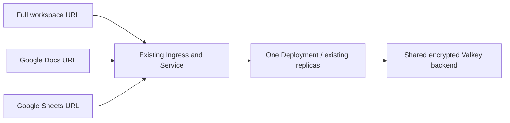

# Specialized MCP URLs with one deployment

Tool profiles expose fixed subsets of the loaded Google Workspace tools on
different hostnames. One Python process and one HTTP port serve all profiles.
The original URL continues to serve the full configured tool set.



## Configuration

Profiles require streamable HTTP and the built-in Google OAuth 2.1 provider
(`MCP_ENABLE_OAUTH21=true`, `EXTERNAL_OAUTH21_PROVIDER=false`). Use the existing
stateless HTTP and shared Valkey configuration for multiple replicas.

With Helm:

```yaml
mcpProfiles:
  gdocs:
    name: Google Docs
    url: https://google-workspace-gdocs-mcp.wengo.com/mcp
    services: [docs]
    tools: [search_drive_files, get_drive_shareable_link, import_to_google_doc]
  spreadsheets:
    name: Google Sheets
    url: https://google-workspace-spreadsheets-mcp.wengo.com/mcp
    services: [sheets]
    tools: [search_drive_files, get_drive_shareable_link, import_to_google_sheets]
```

Without Helm, set `WORKSPACE_MCP_TOOL_PROFILES` to the JSON equivalent of the
`mcpProfiles` map. Do not set both the chart value and the environment variable.

| Setting | Meaning |
| --- | --- |
| Profile key, e.g. `gdocs` | Stable storage namespace; lowercase letters, digits, `_` and `-` |
| `url` | Public HTTPS MCP endpoint, on a unique hostname; defaults to `/mcp` when the path is omitted |
| `name` | Optional name advertised during MCP initialization and OAuth consent |
| `services` | Optional service groups from `core/tool_tiers.yaml`, e.g. `docs`, `sheets`, `gmail` |
| `tier` | `core`, `extended`, or `complete` (default); tiers are cumulative |
| `tools` | Optional additional exact tool names; can also define an entire profile without `services` |
| `portal` | Optional Cloudflare MCP portal client; see [Cloudflare MCP portal](#cloudflare-mcp-portal) |

At least one service or explicit tool is required. Profiles operate on tools
already loaded by `--tools`, tiers, permissions, read-only mode, and the block
list. They cannot restore globally disabled tools. Invalid names, empty profiles,
or explicitly requested tools unavailable under global settings fail startup.
Service groups use the existing tier catalog, so developer/debug tools omitted
from that catalog are not automatically included.

Each profile registers only its selected tools. A client cannot call a tool
outside that profile even if it knows the name. The tool functions and imported
Google libraries are shared; this does not create extra containers or processes.

## Routing and OAuth

Add every profile hostname to the existing ingress, DNS, TLS, and any public
reverse proxy. Route `/` to the same Service and preserve the original `Host`
header. OAuth endpoints and discovery live alongside `/mcp` on each hostname.
`X-Forwarded-Host` is not used to choose a profile.

Register each new hostname's `/oauth2callback` URL in the existing Google OAuth
client (or the configured `GOOGLE_OAUTH_REDIRECT_URI` path, if customized). For
the example above:

- `https://google-workspace-gdocs-mcp.wengo.com/oauth2callback`
- `https://google-workspace-spreadsheets-mcp.wengo.com/oauth2callback`

FastMCP binds each profile's tokens to that profile's issuer and MCP URL. Tokens
from Docs are rejected by Sheets and by the full endpoint. Each profile uses
`profile_<key>` collection prefixes inside the existing encrypted storage. The
full endpoint's prefix, keys and audience are unchanged. Keep profile keys stable
to preserve registrations and refresh tokens across replicas and restarts.

The Google client ID/secret, encryption key and storage connection are shared.
Each new MCP connector has its own OAuth authorization flow. The current full
connector keeps its existing registrations, tokens and configured scope set.

### Google permissions per profile

Each profile automatically requests identity scopes (`openid`, `userinfo.email`
and `userinfo.profile`) plus the Google API scopes declared by its selected tools.
Scopes are derived after global tool filtering, so tiers, read-only mode,
permissions and blocked tools also narrow profile consent. Explicit extra tools
contribute their own scopes. No additional profile settings are needed.

Discovery metadata, default client registration, CIMD defaults and the Google
authorization redirect use that profile's scope set. Requests for scopes outside
the profile are rejected, including from older registrations or CIMD documents
that list broader permissions. Existing registration records are preserved;
their effective scopes are limited when used for a new authorization.

For the complete production profiles, API permissions are:

| Profile | Google API permissions |
| --- | --- |
| Gmail | Gmail reading, sending, drafts, labels and filters |
| Drive | Read files and manage files created/opened with this OAuth application (`drive.readonly`, `drive.file`) |
| Calendar | Calendar and event access |
| Forms | Form content and reading responses |
| Docs | Documents plus Drive access for search, import, export and comments |
| Sheets | Spreadsheets plus Drive access for search, import and comments |
| Slides | Presentations plus Drive access for comments |

The comment-management tools (`manage_document_comment`,
`manage_spreadsheet_comment`, `manage_presentation_comment`) currently require
the full `drive` scope. Omitting those tools from a profile removes that scope
unless another selected tool requires it. Profiles restrict exposed tools, but
Google scopes can still cover more than one document type or operation.

After upgrading from shared scopes, reconnect each specialized connector to
start a new Google authorization. A client caching the old scope list may need
its local OAuth registration reset so it discovers the new list. Existing access
and refresh tokens are not revoked or retroactively narrowed by this change.

Profile authorization sends `include_granted_scopes=false` to avoid requesting
Google's incremental merging of previous grants. Google still tracks consent
for the shared OAuth application: its account permissions page or consent UI
may show access granted previously. Removing an old broad grant at Google
affects other profiles and the full connector using that application; they may
also need to reconnect. Profile hostnames do not create separate Google
application consent/revocation boundaries.

With profiles enabled, the full endpoint is routed on the configured public and
internal base hostnames; unknown hosts return 404. `/health` remains available
on any host except portal edge hostnames, for Kubernetes probes. Without profiles, existing routing is unchanged.
An alternative single-segment MCP path such as `/com` is supported, with matching
OAuth resource metadata. Profiles on different paths of the same hostname are
not supported by this configuration.

## Cloudflare MCP portal

A profile can also serve claude.ai through a Cloudflare MCP portal, which then
acts as a confidential OAuth client of the profile (Terraform:
`terraform-infra/modules/cloudflare_mcp_portal`):

```yaml
mcpProfiles:
  gdocs:
    name: Google Docs
    url: https://google-workspace-gdocs-mcp.wengo.com/mcp
    services: [docs]
    portal:
      edge_host: google-workspace-gdocs-mcp-edge.wengo.com
      client_id: cloudflare-mcp-portal
      client_secret_ssm_parameter: exploit.google_workspace_mcp.portal.gdocs
```

| Setting | Meaning |
| --- | --- |
| `edge_host` | Public hostname of the profile's token endpoint, behind Cloudflare's edge gate Worker. It serves `POST /token` only: anything else, `/health` included, gets a 404 |
| `client_id` | The portal's client id; must differ from the Google client id |
| `client_secret_ssm_parameter` | SSM SecureString holding the client secret, read at startup with the pod's AWS credentials (IRSA, region from `AWS_REGION`). A missing or unreadable parameter stops the startup |
| `redirect_uris` | Optional; defaults to Cloudflare's shared callback, `https://oauth-callbacks.cloudflareaccess.com/cdn-cgi/access/outbound-oauth-callback` |

How the flow runs:

- **The client.** The profile's authorization server answers the portal's
  client id with a fixed client: `client_secret_basic`, the profile's scopes,
  exactly the listed redirect URIs. It is never stored, and DCR can't take its
  id.
- **The browser stays on the profile hostname.** The portal sends the user to
  the profile's own `/authorize` (`private_authorization_endpoint` in the
  Terraform module), then consent and the Google callback. No new Google
  redirect URI is needed.
- **Codes and refresh tokens are redeemed on `https://<edge_host>/token`** by
  Cloudflare's backend, with `Authorization: Basic`. The portal leaves
  `client_id` out of the form, which the MCP SDK requires: the edge gate Worker
  adds it once it has checked the secret.
- **`/mcp` stays on the profile hostname,** which the portal reaches through
  Cloudflare Gateway and a tunnel.
- **Tokens are the profile's own:** same issuer, audience and storage namespace
  as its other clients.

Add `edge_host` to the ingress hosts. Deploy an image with this support before
adding `portal`: older images refuse unknown profile settings at startup.

The tunnel's cloudflared runs from `Dockerfile.cloudflared`: Cloudflare's
binary behind `scripts/cloudflared/entrypoint.py`, which reads the tunnel token
from the SSM parameter in `TUNNEL_TOKEN_PARAMETER` (IRSA), writes it to
`TUNNEL_TOKEN_FILE` (default `/run/cloudflared/token`, an in-memory volume) and
execs cloudflared with the container's arguments. Deployed by
`terraform-helm/modules/cloudflared-mcp-portal`.

## Client setup and release

Create separate MCP connector entries using the specialized URLs. Select the
relevant connector for each agent; attaching the full connector and all profiles
to the same agent would restore the large combined tool inventory.

The `../terraform-helm/modules/google-workspace-mcp` module contains the prepared
Wengo ingress/profile configuration and a rollout document with LibreChat snippets.
Publish a new application image and chart before promoting those settings;
older images ignore the new environment variable. Google callback registration
and public DNS/TLS routing must also be in place before users connect.
